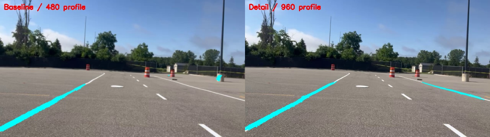

# Detailed detection review

This investigation follows the full-recording review's visible-paint misses in frames 386 and 814. It adds an explicit higher-resolution inspection profile and rejection diagnostics. It does not claim measured real-world precision/recall or change robot deployment defaults.

## What was investigated

At 480 px, both frames have ridge-core evidence before filtering but no final candidate pixels inside the recording crop. A sparse sweep tested a lower ridge threshold, a wider physical-width band, a shorter metric length cutoff, denser ridge scales and higher processing resolutions. Lowering brightness thresholds did not recover the two empty results. A shorter length cutoff recovered paint but also admitted the white round object in frame 386. Wider width bounds did not recover frame 814. These checks were exploratory, not a held-out accuracy evaluation.

The 960 px option recovered substantial painted boundary portions in both frames without relaxing thresholds. The saved `recording_detail.json` differs from `recording_review.json` only in `processing_width` (960 instead of 480). It retains the same camera assumption, lower-45% crop, physical filters, tracking and navigation gates. Intermediate 640/720 px checks recovered only small fragments in frame 814; resolution does not improve every marking monotonically because the ridge operator searches discrete image scales.

Visual inspection also found a retained bright background feature near the shed in frame 814. Central dashes remain missed in these detailed views. More nonempty masks therefore cannot be called more accurate detection. The crop does not guarantee that retained pixels are on the ground, and the recording lacks verified calibration/depth.

## Measured full-recording result — 2026-10-26

Both profiles processed the same 1,078 local frames. [Numerical summary](../validation/detail_review_summary.json) / [complete per-frame trace](../validation/detail_review_frames.jsonl).

| Measurement | Baseline 480 px | Detail 960 px |
| --- | ---: | ---: |
| Empty candidate masks | 32 | 3 |
| Frames with confirmed image candidates | 1,018 | 1,073 |
| Mean detector time | 49.6 ms | 226.0 ms |
| 95th percentile detector time | 68.1 ms | 295.0 ms |
| Navigation-eligible frames | 0 | 0 |

All 32 baseline-empty frames became nonempty, but **three different frames became empty**: 419, 422 and 423. Visual inspection shows the baseline retained right-boundary paint in these three frames while detail lost it. The detail profile is therefore not uniformly better. Do not replace deployment defaults based on the aggregate count. It costs about 4.6 times as much detector time here (roughly 4.4 detector-only frames/second), and is an inspection option, not a real-time recommendation.

The new gate counts pinpoint the investigated baseline failures: frame 386 retained 1,254 pixels after shade filtering and zero after length filtering; frame 814 retained 1,035 and then zero. At 960 px, the corresponding post-length counts were 2,898 and 3,925. These counts use different processing resolutions and are only evidence about where filtering removed candidates, not comparable pixel-recall measurements.



In this saved sample, detail retains more right-boundary paint and removes the lamp-base candidate visible in the baseline. The illustrated paint/object interpretation is a qualitative inspection; it is not reviewed ground truth or a precision/recall score.

## Run the detailed viewer

```bash
python -m avl_white_lines.cli --images examples/raw --config config/recording_detail.json
```

Use I/O for stages, A/D for images, and Space for playback. An actual consecutive recording is needed to assess temporal behavior; the five sample images are far apart. Keep the 480 px profile for lower-cost comparisons. This higher-resolution profile is intended for inspection until timing and accuracy are validated for the intended hardware.

## Reproduce the full-recording comparison

```bash
python scripts/compare_review_profiles.py --images /path/to/consecutive_jpg_frames --output results/detail_review_01
```

A new output directory is required to preserve prior work. The script alternates profile order, processes every supplied JPG, exports per-frame gate counts and SHA-256 identities, and saves candidate-overlay comparisons at uniform intervals and every empty/nonempty difference. `summary.json` records configs, source hashes, platform and detector timings; `frames.jsonl` contains the complete numerical trace. No raw recording is added to the public repository.

Timing includes detector processing and component extraction, excluding image decode, tracking, navigation checking and gallery rendering. Nominal 30 Hz replay timestamps are used for track lifecycle; this is not a physical camera throughput benchmark. Pixel counts at different resolutions are not directly comparable. Empty-mask counts measure an output symptom, not false-negative rate, and confirmed candidate counts are not accuracy.

## Explain an empty output

The ridge result now exposes `diagnostics.gate_pixels`: sequential counts inside the configured region after ridge candidacy, side-darkness, color, width, hysteresis, shade, length and depth filtering. The final dilated mask has its own count. These are additive diagnostics; they do not alter the filters or the existing 18 viewer stages. Full-frame connected-component decisions still precede cropping. See [field definitions](OUTPUT_SCHEMA.md#ridge-rejection-diagnostics).

## What still needs work

Review actual paint centerlines with the [labeling workflow](EVALUATION_WORKFLOW.md), then compare both profiles with the strict <10 native px / <2 degree criterion. Review negatives and background false detections as well as recovered paint. Reserve held-out frames/recordings before tuning further. No reviewed accuracy labels were created by this investigation. Actual measured camera calibration and registered depth remain necessary to qualify navigation evidence on the robot.
