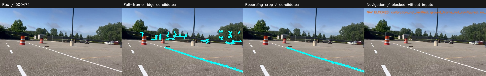

# Current ground-region and navigation validation — 2026-10-23

This update addresses background candidates and their possible use by navigation. It keeps the original AVL program and full-frame Marvin RGB baseline, adds an explicit recording-specific crop, and introduces stricter navigation evidence rather than silently promoting every stable bright strip into a road boundary.

## What changed and why

1. **Optional image region.** `config/recording_review.json` keeps the lower 45% of this recording. Full-frame `marvin_ridge.json` has no extra crop and retains the Marvin RGB parity tests. The crop removes much of the visible tree/fence band here, but also discards far paint. It is not semantic ground recognition or transferable camera calibration.
2. **Dedicated navigation contract.** Candidate masks/JSON remain inspection outputs. Navigation JSON/mask/cloud require explicit verified calibration provenance, a configured ground frame, current registered depth, active ground gating and freshly confirmed unflagged metric tracks. Missing inputs produce explicit block reasons, empty evidence and zero validity.
3. **Measured-depth geometry.** Navigation mask pixels intersect current candidate/depth-confirmation masks. Cloud samples use measured optical depth and the mount geometry, not RGB-only floor extrapolation. Actual measured range is bounded as well as model-based range.
4. **Input validation.** Optional rectified CameraInfo updates intrinsics and resets state on changes. Unsupported/unadjusted crop/binning/skew/baseline projection is rejected. RGB/depth must have matching sizes and nonempty matching optical frame IDs. Missing, stale or unsynchronized depth cannot qualify navigation.
5. **Freshness and watchdog.** Duplicate/backward RGB stamps, stream loss, errors and missed deadlines clear navigation evidence; publication rechecks source age. A receiver helper rejects blocked/wrong-role/expired evidence and must be called as time passes without new messages. Actual planner stop/fallback integration remains external.
6. **Performance and organization.** Cheap metric-association rejection runs before all-pairs distances. Robot templates/local configs and per-camera launch commands replace implicit defaults. Current docs are indexed separately from dated historical reports.

## Five-frame sparse visual audit

These are the unchanged raw samples 0, 410, 474, 710 and 1077. The example camera preset remains **unverified** for this recording and no registered depth exists. A visually chosen upper-background band spans 15%-45% image height. One coarse near-paint checkpoint per frame checks local paint retention. They are **not** full lane labels, precise centerline annotations or held-out accuracy data.

| Frame | Hits in audited background band, full frame | Hits after recording crop | Distance from near-paint checkpoint to retained mask (px) |
| --- | ---: | ---: | ---: |
| frame_000000.jpg | 995 | 0 | 0.00 |
| frame_000410.jpg | 1221 | 0 | 1.00 |
| frame_000474.jpg | 1585 | 0 | 0.00 |
| frame_000710.jpg | 1231 | 0 | 0.00 |
| frame_001077.jpg | 541 | 0 | 6.40 |

The crop makes the selected upper-band count zero by construction; that is an explicit spatial constraint, not a learned ability to distinguish trees. All five selected near-paint neighborhoods retain a mask within 10 px. This does not establish whole-line recall or the <2 degree angle criterion on real footage. Other ground/background candidates below the crop remain possible. All five navigation outputs correctly stay **ineligible** without measured calibration and depth.

## Sequential and runtime smoke

The earlier full recording is available locally (1,078 frames) but is not added to the public repository. The audit replays its first **120 consecutive frames**, frame_000000.jpg through frame_000119.jpg, at a nominal 30Hz replay clock, not measured acquisition timestamps.

- Recording-profile pipeline compute: mean **54.6 ms**, p95 **65.7 ms**, including detection, tracking and navigation gating; excluding disk decode, GUI, ROS/capture and real depth fitting.
- Confirmed image candidates on **118/120** frames; **3** distinct session track IDs. This is not a labeled ID-switch or fragmentation score.
- Navigation-eligible frames: **0**, as required for missing calibration/depth.
- Five-image warm detector comparison: full-frame mean **107.6 ms**, recording crop mean **60.4 ms** (25 timed samples). The crop reduces component work; it changes coverage, so these are not equivalent-coverage accuracy/speed rankings.

CPU timings vary by load/scene. They do not establish 30 FPS, three-camera throughput, Jetson thermals, sensor latency or robot performance. [Raw data, exact settings and source/image hashes](../validation/ground_improvement.json).

## Verification

- **117 tests pass locally**, preserving all original 35. Added tests cover ROI/paint checkpoints, measured-depth navigation points/pixels, out-of-range rejection, missing/unverified calibration, missing depth, fallback/held/tentative/flagged tracks, malformed/stale inputs, CameraInfo/registration validation, watchdog expiration and adapter publication/invalidation callbacks.
- The ROS callback contract is tested with message doubles: waiting for CameraInfo, valid depth and three-hit confirmation, wrong depth frame, duplicate RGB stamp, stream timeout and wrong CameraInfo frame. This exercises adapter code without proving actual ROS middleware/driver behavior.
- **15/15 original final images are pixel- and PNG-byte-identical locally**; full-frame RGB masks retain their upstream parity regression tests. Original viewer source/reference assets are unchanged.
- Compile, documentation-link and shell-syntax checks are recorded with this release; CI repeats Python tests and original pixel/link checks.

Reproduce the sparse audit with `python scripts/audit_ground_outputs.py --output results/ground_audit`. Add `--sequence /path/to/consecutive_frames --sequence-frames 120` to replay local footage. `index.html` in the output folder contains the review gallery. No extra real frames are distributed here.

## Remaining work before physical navigation

| Item | Current state / required evidence |
| --- | --- |
| Recorded-camera intrinsics and mount | Unverified. Obtain measured rectified values; do not infer them from the supplied preset. |
| Robot RGB/depth registration and timing | Code checks implemented; physical pairing/coverage and dynamic scene behavior untested. |
| TF and costmap placement | Explicit local ground frame required; actual transform/RViz placement and costmap persistence/clearing untested. |
| Planner safety interlock | Availability helper supplied; connect it to the actual planner/controller's validated hold/fallback behavior. Empty means unknown, not clear road. |
| Labeled real accuracy | No reviewed full masks/centerlines or adverse-condition labels. Sparse checkpoints and synthetic tests cannot establish general accuracy. |
| Hardware performance | Measure Jetson acquisition-to-output age, three-camera load, dropped frames and thermal behavior. |
| Controlled robot testing | Stationary and replay checks first; no autonomous driving validation is claimed. |

## Read the organized guides

[Quick start](QUICK_START.md) → [configuration](../config/README.md) → [navigation rules](NAVIGATION_OUTPUTS.md) → [robot setup](ROBOT_SETUP.md). [Documentation map](INDEX.md), [repository guide](REPOSITORY_GUIDE.md), [change log](../CHANGELOG.md) and [validation index](../validation/README.md) keep current behavior distinct from the earlier experiments.
