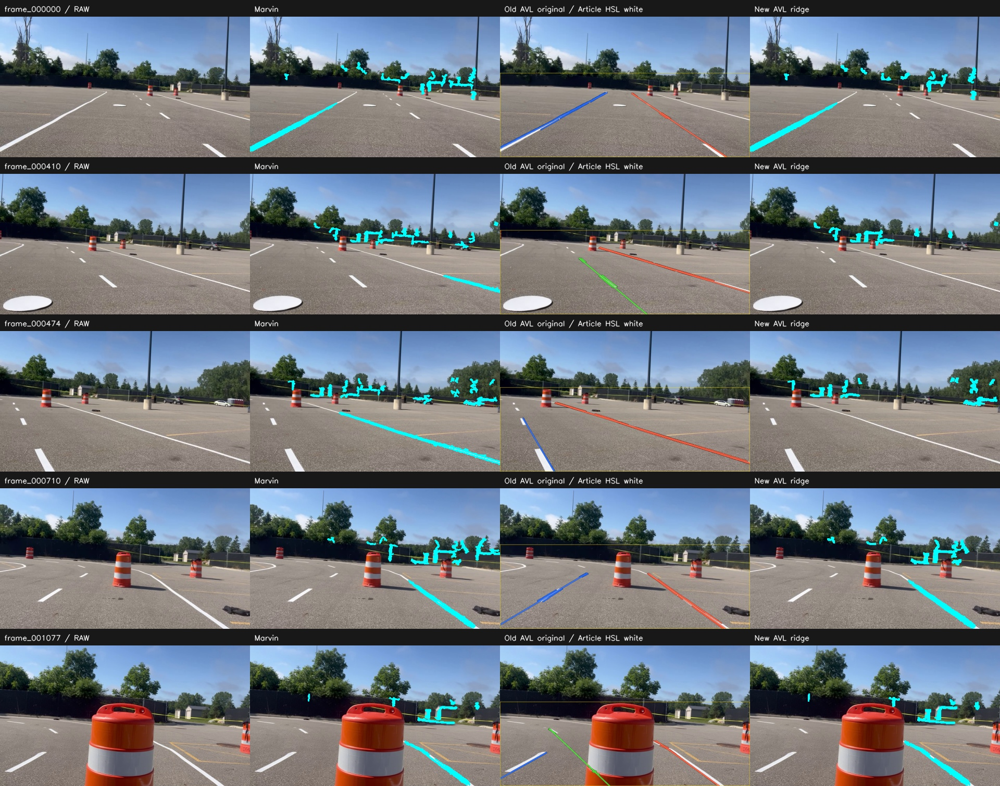

# Marvin, old AVL, and new AVL

Here **old AVL means the original `lane_pipeline_viewer.py` / `original_viewer.process` program**, not the tracked legacy Hough rewrite used as the third column of the previous comparison. New AVL means the updated `marvin_ridge` backend plus its tracking/output framework. Marvin means the unmodified standalone upstream detector.

## What was compared

Frames **0, 410, 474, 710, 1077**, using unchanged native 1280x720 source JPEGs. Old AVL uses native resolution, rectangular ROI and its original filters; both ridge versions internally process at width 480 with the same `marvin_front` preset. That preset is unverified for this recording. No depth or live plane fitting was supplied. These are single-frame detector views; the new tracker is not assessed using these five widely separated images.

All three original filters are included in the local gallery: Article HSL white, Previous HSV and Saved HSL. **All 15 old AVL final outputs match the existing reference images pixel-for-pixel.** The primary image below uses Article HSL white, preserving old AVL's group colors and ROI outline. Cyan in Marvin/new AVL shows segmentation rather than confirmed tracks.



## Findings on these five views

- **Old AVL produces the least visible background clutter in the primary Article HSL views.** Its lower-image ROI and line geometry keep the output focused on road markings. It retains markings that the new ridge path misses in frames 410 and 474. This is visual inspection, not labeled accuracy.
- **Marvin retains more visible paint than new AVL in those two frames**, but both ridge versions also highlight background objects/fences/vegetation under the unverified camera model and RGB-only conditions.
- **New AVL is not the detection winner here.** Its extra physical component checks remove genuine visible paint as well as candidates. Its main additional value is tracking, metric components, debugging and output/freshness infrastructure.
- Old AVL still fits straight lines and extrapolates to the image bottom. Frame 1077 shows a fit crossing the foreground barrel rather than tracing only observed paint. Its cleaner appearance therefore does not establish better performance on curves, occlusions or general scenes.

There are no reviewed real labels or verified intrinsics/mount measurements. No overall accuracy ranking is defensible from these five images. Correct calibration and depth could materially change both ridge results.

## Timing on this computer

Seven repetitions per image after warm-up, rotating algorithm order. All algorithms receive the same source image for each timing condition.

| Program | Native input mean ms | Native input p95 ms | Common 480px input mean ms |
| --- | ---: | ---: | ---: |
| Marvin | 54.7 | 77.6 | 46.3 |
| Old AVL original | 97.6 | 141.6 | 14.2 |
| New AVL ridge | 152.6 | 210.3 | 134.7 |

For native inputs, old AVL computes at 1280x720; ridge versions internally downscale to 480px. The common-480 column removes that resolution difference, but changes the old program's pixel-scale behavior and should not replace its original native-resolution reference results. Old AVL always computes all 17 stages and the overlay; Marvin returns a mask and new AVL extracts metric components. These are different workloads. No timing includes camera acquisition, GUI display, logging or new AVL temporal tracking; none establishes Jetson/three-camera FPS. See [saved measurements and settings](../validation/three_version_comparison.json).

## Capabilities

| Feature | Marvin | Old AVL original | New AVL |
| --- | --- | --- | --- |
| Detection method | Physical log/Hessian ridges | HSL/HSV, Canny, Hough, straight fits | Adapted Marvin ridges plus component checks |
| Curved segmentation | Yes | Straight fits only | Yes, with sampled metric centerlines |
| Metric camera calibration | Required | Not needed for 2D output | Required for ridge mode |
| Depth/object rejection | Yes | No | Yes, with stricter ground confirmation |
| Temporal IDs/smoothing/confirmation | No detector tracker | No | Yes |
| Debugging | Internal ridge maps | Original 17-stage viewer | Original viewer retained, plus 15 ridge stages |
| JSON freshness / optional point cloud | No equivalent tracked contract | No | Yes |
| CameraInfo intrinsics in ROS | Yes | No ROS adapter in original viewer | JSON camera configuration |

Recommendation: preserve **old AVL as the visual baseline**, **Marvin as the segmentation reference**, and **new AVL as the tracking/integration candidate**. The new detector still needs calibration and correction of the observed paint rejections before it can be called better than either baseline.

## Browse and reproduce

The generated gallery has raw, Marvin, old AVL and new AVL columns. **A/D** or arrows changes images; **I/O** switches overlays/masks; **M** cycles old AVL's three filters. In mask view, old AVL shows the accepted/fitted drawing mask, not a semantic paint mask. The gallery controls were verified in a browser.

```bash
python scripts/compare_three_versions.py --marvin-repo ../Marvin_White_Line --output results/three_versions --repeat 7
```

Open `results/three_versions/index.html`. The original viewer and all detector implementations are unchanged by this comparison.
