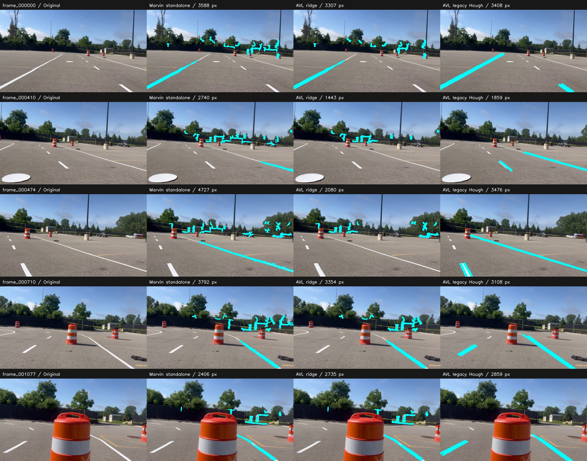
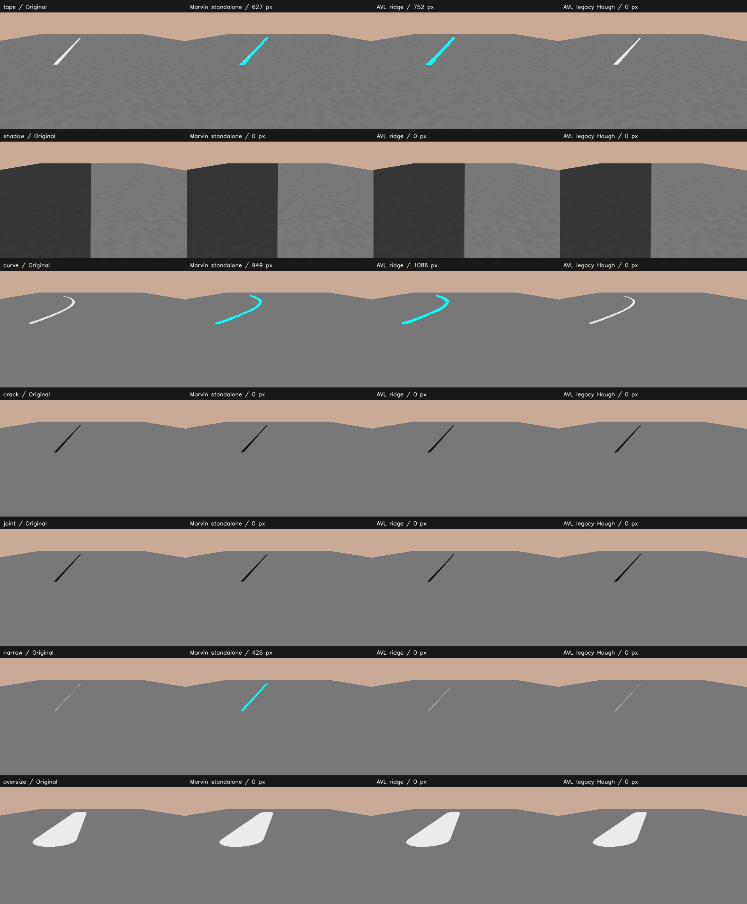

# Standalone Marvin versus updated AVL

Historical comparison before the segmentation fix: the extra component gate and dilation regressions described here have since been corrected in the default policy. See [current behavior and measurements](SEGMENTATION_FIX.md).

Measured 2026-10-23, comparing upstream Marvin `d6aa919` with AVL's ridge integration `8fb2b5e`. AVL also retains its legacy Article HSL/Hough backend; that third baseline is included in every comparison image.

**The updated AVL is not an established accuracy improvement over standalone Marvin.** It adds useful tracking/output/debugging infrastructure, but its extra component filters cost CPU and can reject real paint when calibration is wrong. Standalone Marvin is faster in this local comparison.

## Same-input measurements

Frames **0, 410, 474, 710, 1077** were resized once to width 480 and sent identically to all three detectors. Both ridge detectors used the same `marvin_front` camera preset and default ridge/width/length thresholds; live ground fitting and depth were disabled. The real images have **no verified camera calibration or reviewed labels**, so these are timing and visual comparisons, not real-world precision/recall. Seven timed repetitions per image, with algorithm order rotated, follow untimed warm-up calls.

| Detector | Mean detection ms | p95 ms | Compute FPS |
| --- | ---: | ---: | ---: |
| Marvin standalone | 48.3 | 57.4 | 20.7 |
| AVL ridge | 139.1 | 173.1 | 7.2 |
| AVL legacy Hough | 5.4 | 6.2 | 185.3 |

These timings exclude decoding/resizing, tracking, rendering, logging, ROS and hardware acquisition. AVL ridge includes physical centerline extraction, width measurement and component confidence, while Marvin returns a mask; the workloads are intentionally identified rather than claimed identical. FPS is single-stream CPU compute capacity, not camera or robot throughput.



Columns are original, Marvin standalone, AVL ridge, AVL legacy Hough. Cyan is current-frame output before temporal confirmation. Legacy Hough rasterizes fitted lines, which is not the same target as a pixel paint mask.

Visual inspection finds:

- Both ridge versions detect off-road fence/vegetation/background features with the assumed calibration and no depth. Neither is clean enough here to claim robot readiness.
- In frames 410 and 474, the AVL component checks remove visible paint that standalone Marvin retains. Frame 474 loses the main right-hand marking in the AVL ridge result.
- In frame 1077, AVL retains all 2,406 upstream mask pixels and adds 329 border pixels. That is thicker coverage, not evidence of better detection.
- The legacy Hough result visually avoids much of the background clutter in these five views but remains straight-line based and can fit unsupported extensions. It should not be judged as a semantic segmentation mask.

## Known synthetic labels

Both detectors use the same known camera model for the synthetic ground scenes. Pixel metrics include all returned border/dilation pixels, with no tolerance band.

| Scene | Marvin precision / recall | AVL ridge precision / recall |
| --- | ---: | ---: |
| tape | 78.6% / 89.2% | 70.1% / 95.3% |
| curve | 69.9% / 99.1% | 61.6% / 100.0% |

AVL has higher pixel recall but lower precision on these two positive fixtures. One cause is implementation-specific mask dilation: AVL rebuilds its final mask with a square 3x3 kernel, while upstream uses a 3x3 ellipse. Added border pixels are therefore not extra independent ridge evidence.

Both reject the tested shadow edge, dark crack/joint and oversized bright strip. On the 1 cm bright-strip negative, upstream produces 426 mask pixels and AVL rejects it. These fixtures are also used during development; they are not a held-out benchmark.



The depth fixtures show both retaining tape on the ground and rejecting a raised bright stripe. With the intentionally inconsistent farther-than-ground depth, upstream still returns 627 pixels and AVL returns zero: AVL's symmetric depth check requires agreement with the floor, while upstream's confirmation only excludes nearer surfaces. This is a controlled consistency test, not a real depth-camera accuracy measurement.

## Capability comparison

| Capability | Standalone Marvin | Updated AVL |
| --- | --- | --- |
| Physical ridge/color/shadow/width/length detection | Yes | Adapted from Marvin, plus component checks |
| Curved paint mask | Yes | Yes |
| Metric sampled component centerlines | Ground geometry internal; public detector returns mask | Public component and track metadata |
| Temporal IDs, smoothing, three-hit confirmation | No detector tracker | Yes |
| Held/expired tracks and freshness-aware JSON | No equivalent track contract | Yes |
| Optional depth rejection/live ground | Yes | Yes; stricter floor confirmation and extra smoothing |
| Live ROS CameraInfo intrinsics | Yes | JSON calibration; not subscribed automatically |
| ROS output | Mask and overlay | Mask, debug, JSON, optional valid metric point cloud |
| Inspection | Ridge debug maps available internally | 15 selectable ridge stages plus original 17-stage viewer |
| Legacy HSL/HSV/Hough comparison | No AVL legacy backend | Included |

Standalone Marvin's repository describes deployment in Marvin's costmap stack. That upstream report was not independently verified on a physical robot in this comparison. Updated AVL's ROS adapter and point-cloud path remain hardware-untested.

## Recommendation

Keep Marvin as the segmentation reference and AVL as the tracking/debugging/output framework. Do not assume AVL's extra filtering improves accuracy. Calibrate the real recording/robot first, examine the paint removed in 410/474, align mask dilation when assessing segmentation, then evaluate on reviewed labels and sequential recordings. Until that is done, neither these results nor the synthetic gains justify promoting the modified AVL detector as a proven better production detector.

Reproduce from the AVL repository (upstream checkout and the pytest/test extra are required for synthetic fixtures):

```bash
python scripts/compare_marvin_avl.py --marvin-repo ../Marvin_White_Line --output results/marvin_vs_avl --repeat 7
```

Open the generated `index.html` for every image and download `comparison.json` for timings, masks counts, synthetic metrics, settings and source hashes. [Saved measurements](../../validation/marvin_vs_avl.json).
