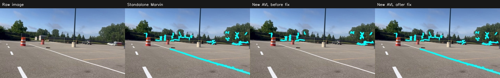

# Restore Marvin segmentation and explain component decisions

The extra AVL component filtering introduced in the first integration caused a real regression. Its secondary width estimate classified visible road paint in frames 410/474 as roughly **1.8–1.9 cm** under the unverified camera model, then rejected it against a **2.5 cm** minimum. This was an estimate from assumed geometry, not a measurement of the real paint. Rebuilding the output with a square dilation also made masks thicker than upstream Marvin's elliptical dilation.

## Changes

- Default `component_policy="diagnostic"` retains the ridge operator's segmentation and original elliptical dilation. The second width/centerline-length check annotates components instead of silently deleting pixels. Upstream physical width, length, shade, color and depth gates remain active.
- `quality_flags` and frame `diagnostics` explain uncertain dimensions; flagged component confidence is multiplied by .75. Tracking can retain visible evidence, but the optional costmap point cloud excludes flagged tracks. Tracking validity does not certify physical dimensions or semantic paint correctness.
- `config/marvin_ridge_strict.json` explicitly opts into the secondary rejection policy for calibrated evaluation. It retains strict narrow-object rejection tests. The default can keep upstream false positives, including the tested 1 cm bright strip; this tradeoff is intentional and tested, rather than hidden behind a claim of better accuracy.
- Geometry shared across components is computed once per frame. Component pixels are extracted within their bounding boxes, and direct width profiles use at most 192 well-resolved samples per component. This reduces overhead while retaining metric components and tracking.
- Depth confirmation still requires symmetric agreement with the floor. RGB-only parity does not imply identical behavior for intentionally inconsistent depth.

## Five-frame RGB parity

Same 480px images, same camera model, no depth/live fitting, no tuning:

| Frame | Marvin mask pixels | AVL before fix | AVL after fix |
| --- | ---: | ---: | ---: |
| frame_000000 | 3588 | 3307 | 3588 |
| frame_000410 | 2740 | 1443 | 2740 |
| frame_000474 | 4727 | 2080 | 4727 |
| frame_000710 | 3792 | 3354 | 3792 |
| frame_001077 | 2406 | 2735 | 2406 |

The after masks are **pixel-identical**, not merely equal in count: there are zero added and zero removed pixels for every frame. Five independent upstream mask hashes are saved with image hashes and camera settings in `tests/fixtures/marvin_rgb_reference.json`. Runtime parity tests also compare the segmentation before/after component extraction. Frozen exact hashes are checked on the matching OpenCV/platform; other platforms check same-runtime kernel parity.

The new default therefore restores Marvin's segmentation baseline, not superior accuracy. It also restores the false background hits present in that baseline under the assumed camera model.

## Checks and timings

- **70 tests pass**, including all original 35, five real-frame mask parity cases, confirmed tracking near the previously rejected road paint in 410/474, explicit strict-policy checks, costmap exclusion and the diagnostic/strict narrow-strip tradeoff.
- **15/15 original viewer outputs remain pixel- and PNG-byte-identical locally.** The original viewer is unchanged.
- Local interleaved warm-run RGB detection comparison, seven repeats per image: standalone Marvin **47.3 ms/frame**, updated AVL ridge **102.5 ms/frame**. Both receive identical 480px input. New AVL also computes metric component metadata; these timings exclude tracking/rendering/ROS/capture.
- A separate cold five-frame CLI run including tracking measured **192.5 ms/frame**. Do not confuse that complete CLI result with the warmed detector-only timing. No 30 FPS or three-camera robot claim is supported.
- Compilation, original-reference verification and `git diff --check` passed. [Full measurements](../../validation/segmentation_fix.json).

## What still needs improvement

1. Use measured rectified intrinsics, height and pitch for these images or the robot. The example `marvin_front` preset is unverified for this recording; guessed ground geometry can include background objects and distort width estimates.
2. Supply registered metre depth to reject above-floor objects, with timestamps and valid-depth coverage checked on the robot. This path remains hardware-untested.
3. Label representative sequential footage before changing segmentation thresholds. Evaluate missed paint, false positives, curve error and ID continuity, including shadow/exposure changes. The five separated samples cannot establish tracking stability.
4. Profile the complete camera/depth/tracker/ROS path on the Jetson. Tracking smooths evidence; it cannot turn a wrong mask into correct paint detection.

Run the default with `--config config/marvin_ridge.json`; use `config/marvin_ridge_strict.json` only when deliberately evaluating the extra component gates. `component_policy` is independent of the three backend choices. Old AVL and legacy Hough behavior are unchanged.
