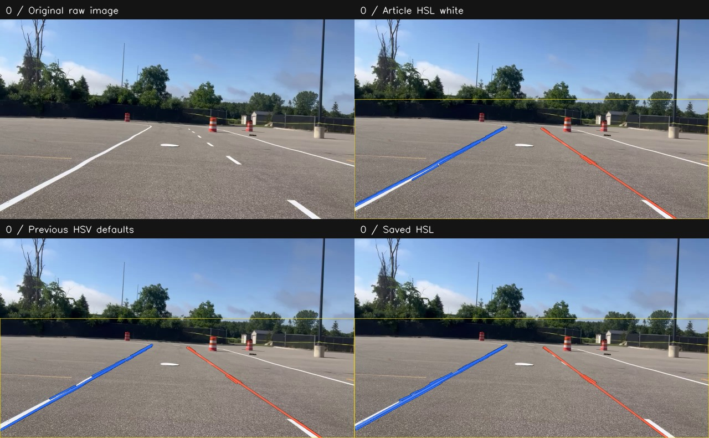
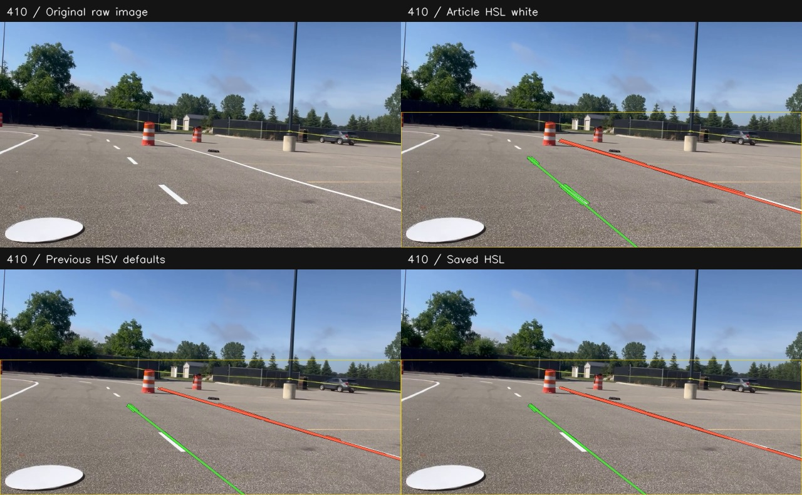
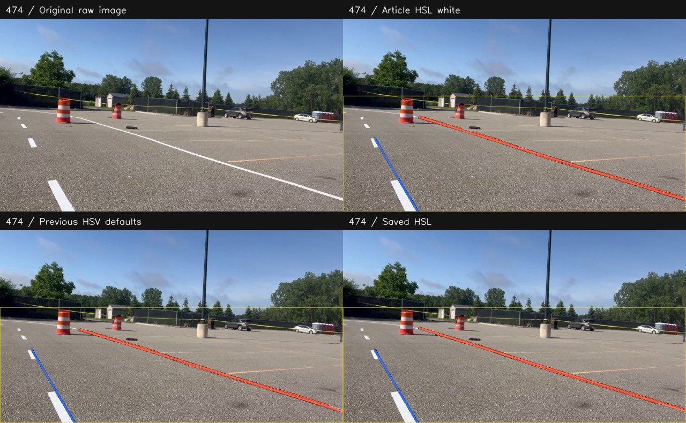
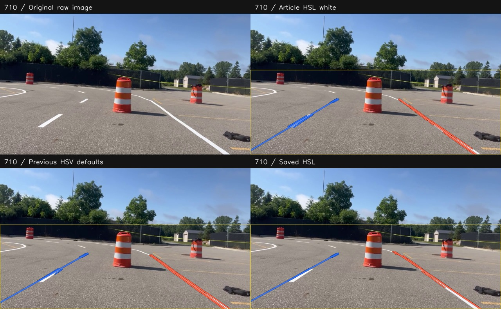
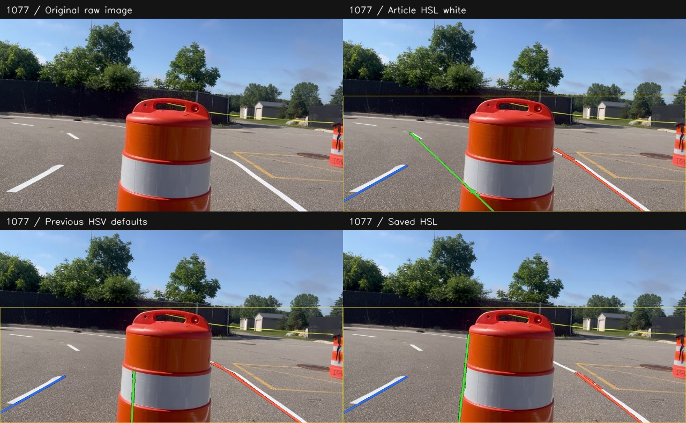

# Five original raw frames and their results

These are the actual raw JPEGs from the earlier projects, copied without recompression. Only these five raw frames are included; the full 1,078-frame set is not uploaded.

Results use the **restored original detector**, all three filters, native 1280×720 input, and the rectangular ROI starting 40% down from the top. There is no tracking or input resizing.

Download the repo/ZIP and open **gallery.html** here for I/O stage switching, A/D image switching, and M filter switching. It runs offline. GitHub shows the static comparisons below. Stage previews are resized to 640 pixels wide after detection; final PNGs remain full resolution.

In each grid: **original** (top left), **Article HSL white** (top right), **Previous HSV defaults** (bottom left), **Saved HSL** (bottom right). Results are shown as generated, including misses or incorrect fits.

## Frame 0



[Raw JPEG](raw/frame_000000.jpg) · [Article HSL white final](generated/frame_000000/article_hsl_white/final.png) · [Previous HSV defaults final](generated/frame_000000/previous_hsv/final.png) · [Saved HSL final](generated/frame_000000/saved_hsl/final.png)

## Frame 410



[Raw JPEG](raw/frame_000410.jpg) · [Article HSL white final](generated/frame_000410/article_hsl_white/final.png) · [Previous HSV defaults final](generated/frame_000410/previous_hsv/final.png) · [Saved HSL final](generated/frame_000410/saved_hsl/final.png)

## Frame 474



[Raw JPEG](raw/frame_000474.jpg) · [Article HSL white final](generated/frame_000474/article_hsl_white/final.png) · [Previous HSV defaults final](generated/frame_000474/previous_hsv/final.png) · [Saved HSL final](generated/frame_000474/saved_hsl/final.png)

## Frame 710



[Raw JPEG](raw/frame_000710.jpg) · [Article HSL white final](generated/frame_000710/article_hsl_white/final.png) · [Previous HSV defaults final](generated/frame_000710/previous_hsv/final.png) · [Saved HSL final](generated/frame_000710/saved_hsl/final.png)

## Frame 1077



[Raw JPEG](raw/frame_001077.jpg) · [Article HSL white final](generated/frame_001077/article_hsl_white/final.png) · [Previous HSV defaults final](generated/frame_001077/previous_hsv/final.png) · [Saved HSL final](generated/frame_001077/saved_hsl/final.png)

## Reproduce

From the repository root:

```bash
python scripts/generate_examples.py
python lane_pipeline_viewer.py examples/raw
```

Raw-file SHA-256 hashes and detector/runtime metadata are recorded in manifest.json. These are visual examples, not labeled accuracy measurements.
